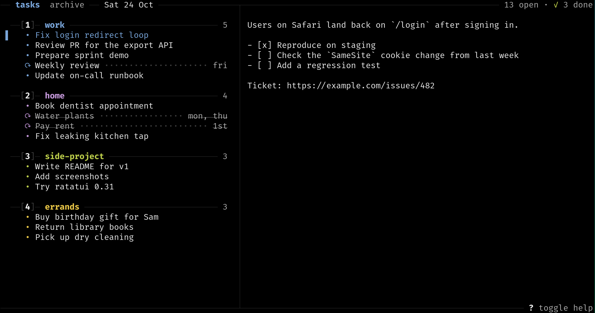
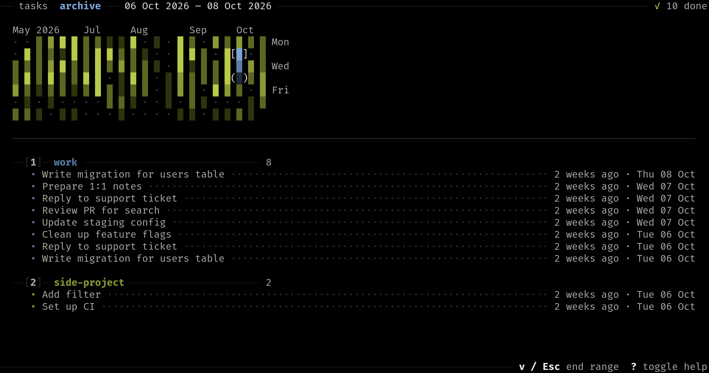

# markoff

> `markdown` + `checkoff` = `markoff`

A terminal task manager where every task is a markdown file.



> [!WARNING]
> markoff is experimental. Keys, config and the file layout can change between versions, without a migration.
> Check the [changelog](CHANGELOG.md) before updating, or stay on a version that works for you.

## Why

- **Plain files.** A section is a directory, a task is a markdown file. Keep them in git, sync them, edit them with anything.
- **Your editor.** You write in your `$EDITOR`, markoff does the quick actions: reorder, check off, undo.
- **Keyboard first.** Vim-like keys, every action can be undone.
- **Notes included.** A task is a whole file, with room for links, checklists and context.
- **Repeating tasks.** A cron-like rule in the heading brings a task back on its days.
- **Stays small.** Made for short-term tasks. Done ones move to a dated archive, with a heatmap of what you got done.

## Install

Prebuilt binaries for Linux (x86_64, ARM) and macOS (Apple Silicon), from the [releases](https://github.com/eckon/markoff/releases) or with the installer:

```sh
curl --proto '=https' --tlsv1.2 -LsSf https://github.com/eckon/markoff/releases/latest/download/markoff-installer.sh | sh
```

Run it again to update. To uninstall, delete `~/.local/bin/markoff`.
If `~/.local/bin` was not on your `PATH`, the installer also added it to your shell config.

From source:

```sh
cargo install --locked --git https://github.com/eckon/markoff
```

## Quick start

Point markoff at a directory (first match wins):

```sh
markoff --dir ~/notes/tasks
MARKOFF_DIR=~/notes/tasks markoff
```

```toml
# ~/.config/markoff/config.toml
[general]
dir = "~/notes/tasks"
```

In an empty directory, press `N` for a section, then `o` for a task.
Both open your editor: write the title after `# `, save and quit.
Notes go below a task's title, `<CR>` opens the task again.

The editor is `$VISUAL`, then `$EDITOR`, then `vi`. `?` shows all keys.

## Files

```text
<root>/
  .markoff             <- order, and when repeating tasks were last done
  .archive/
    2026-10-14/        <- tasks done that day, laid out like the root
      work/
        old-task.md
  notes.md             <- ignored, files in the root are not tasks
  work/                <- section "work"
    fix-login-bug.md   <- task "# Fix login bug"
    review-pr.md
```

- Filenames follow the title. Files added or edited by hand are renamed on start and before the next change.
- `.markoff` is written by markoff. Add it to `.gitignore` to keep order changes and done dates out of git.
- Done tasks (`X`) move unchanged to `.archive/YYYY-MM-DD/<section>/`.

## Repeating tasks

A rule as inline code at the end of the heading makes a task repeat:

```markdown
# Water plants `* * mon`
```

The rule is the day part of cron: day of month, month, day of week. Both day fields have to match, `1 * mon` is a Monday the 1st.

| Rule          | Repeats                   |
| ------------- | ------------------------- |
| `* * *`       | Every day                 |
| `* * mon-fri` | Every weekday             |
| `* * thu`     | Every Thursday            |
| `1 * *`       | On the 1st of every month |
| `1 1 *`       | Every year on January 1st |

`X` on a repeating task hides it until the next day of its rule. A missed day stays until it is done. `.` shows hidden tasks.

## Archive

`Tab` opens the archive: a heatmap of the days you got things done, and the tasks of the selected day or range. Read-only.



## Keys

All keys are also in the help, `?` on any page.

<details>
<summary>Key reference</summary>

### Move

| Key         | Action                                      |
| ----------- | ------------------------------------------- |
| `j` / `k`   | Down / up, also `↓` / `↑`                   |
| `gg` / `G`  | Top / bottom, also `Home` / `End`           |
| `{` / `}`   | Previous / next section                     |
| `1`-`9`     | Jump to section, the number in `[1]`        |

### Change

| Key         | Action                                      |
| ----------- | ------------------------------------------- |
| `J` / `K`   | Move down / up, also `S-↓` / `S-↑`          |
| `<CR>`      | Open task in `$EDITOR`, or rename section   |
| `o` / `O`   | New task below / above                      |
| `N`         | New section                                 |
| `X`         | Done: archived, a repeating task hides      |
| `D`         | Delete task, or empty section               |
| `u`         | Undo                                        |

### Show

| Key         | Action                                      |
| ----------- | ------------------------------------------- |
| `p`         | Toggle the preview next to the list         |
| `.`         | Toggle hidden tasks: repeating, not due     |

### Global

On every page.

| Key         | Action                                      |
| ----------- | ------------------------------------------- |
| `/`         | Filter titles and bodies, `<CR>` keeps it   |
| `/` `Esc`   | Clear filter                                |
| `?`         | Toggle help, also closes with `Esc`         |
| `Tab`       | Next page: tasks, archive, `S-Tab` back     |
| `q` / `C-c` | Quit                                        |

### Archive page

| Key         | Action                                      |
| ----------- | ------------------------------------------- |
| `h` / `l`   | Heatmap left / right, also `←` / `→`        |
| `j` / `k`   | Heatmap a day down / up, list down / up     |
| `H` / `L`   | Like `h` / `l`, skips empty cells           |
| `J` / `K`   | Like `j` / `k` in the heatmap, skips empty  |
| `gg` / `G`  | Heatmap first day done / today              |
| `v`         | Select a range from here, `v` again ends it |
| `<CR>`      | Go to the tasks of the selected days        |
| `Esc`       | Back to the heatmap, there it ends a range  |
| `p`         | Toggle the preview, in the list             |
| `/`         | Filter, its own: the list keeps the matches |

In the archive list `gg` / `G`, `{` / `}` and `1`-`9` work like in the task list. `1`-`9` in the heatmap jump into the list. With a filter, cells without a match turn gray and `H` / `J` / `K` / `L` skip them.

In the filter, `C-w` deletes the last word. While a filter is set on the tasks page, moving and adding tasks is off.

</details>

## CLI

For scripts:

| Command                 | Action                                                        |
| ----------------------- | ------------------------------------------------------------- |
| `list`                  | Print sections and tasks as markdown, in the order of the TUI |
| `add <section> <title>` | Add a task at the end of an existing section, print its path  |

`markoff --help` shows all arguments.

## Development

```sh
cargo test
cargo clippy --all-targets
cargo run -- --dir <scratch dir>
```

`./assets/make-example.py <dir>` builds an example root with a few months of archive, to try changes without touching your own notes. The screenshots are made from it.

Design rules are in [AGENTS.md](AGENTS.md).
